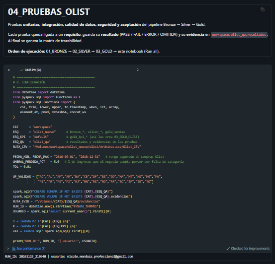
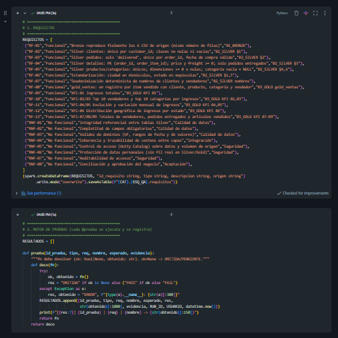

# Suite de Pruebas y Calidad de Datos — Pipeline Olist (`04_PRUEBAS_OLIST`)

Suite automatizada de aseguramiento de calidad (QA) en **Databricks** (PySpark / Spark SQL / Unity Catalog) para validar el pipeline Medallion **Bronze → Silver → Gold** sobre el dataset de Olist.

Cada caso de prueba queda vinculado a un requisito funcional (`RF`) o no funcional (`RNF`), registra su estado (`PASS`, `FAIL`, `ERROR`, `OMITIDA`) en Delta Lake (`workspace.olist_qa.resultados`) y exporta evidencias auditablemente trazables junto con la matriz de trazabilidad.

---

## Contenido de la Carpeta

* [`04_PRUEBAS_OLIST`](./04_PRUEBAS_OLIST) — Notebook principal en formato fuente Databricks con el motor de pruebas `@prueba`, definición de 21 requisitos, 37 casos de prueba automatizados y generación de la matriz de trazabilidad.
* **Evidencias de ejecución (capturas de resultados):**
  * [`1.png`](./1.png) — Configuración inicial (`RUN_ID`, esquemas y volumen de evidencias) y carga de requisitos.
  * [`2.png`](./2.png) — Inicialización del motor de pruebas y resumen general de ejecución.
  * [`3. Pruebas unitarias (UT).png`](./3.%20Pruebas%20unitarias%20(UT).png) — Resultados de `UT-01` a `UT-07`.
  * [`4. Pruebas de integración (IT).png`](./4.%20Pruebas%20de%20integraci%C3%B3n%20(IT).png) — Resultados de `IT-01` a `IT-06`.
  * [`5. Calidad de datos (DQ).png`](./5.%20Calidad%20de%20datos%20(DQ).png) — Resultados de `DQ-01` a `DQ-07`.
  * [`6. Seguridad (SEC).png`](./6.%20Seguridad%20(SEC).png) — Resultados de `SEC-01` a `SEC-05` y `SEC-07`.
  * [`7. Aceptación (UAT) 1.png`](./7.%20Aceptaci%C3%B3n%20(UAT)%201.png) — Resultados de aceptación (Parte 1: `UAT-01` a `UAT-06`).
  * [`7. Aceptación (UAT) 2.png`](./7.%20Aceptaci%C3%B3n%20(UAT)%202.png) — Resultados de aceptación (Parte 2: `UAT-07` a `UAT-11`) y matriz de trazabilidad.

---

## Cobertura de Pruebas (37 Casos Ejecutados)

| Categoría | Código | Cantidad | Alcance y Validaciones Principales | Evidencia |
|---|---|---|---|---|
| **Unitarias** | `UT-01` a `UT-07` | 7 | Funciones de limpieza en DataFrames sintéticos: deduplicación, nulos, `trim`/case de ciudad y UF, filtrado de pedidos `delivered`, rangos de precios/dimensiones y seudonimización determinista (`xxhash64`). | [Ver captura](./3.%20Pruebas%20unitarias%20(UT).png) |
| **Integración** | `IT-01` a `IT-06` | 6 | Paridad de conteos CSV vs. Bronze, existencia de las 22 tablas del ecosistema (6 Bronze, 6 Silver, `gold_ventas`, 9 KPIs), retención Silver ≤ Bronze, recálculo de `JOIN` en `gold_ventas` y orden cronológico (`DESCRIBE HISTORY`). | [Ver captura](./4.%20Pruebas%20de%20integraci%C3%B3n%20(IT).png) |
| **Calidad de Datos** | `DQ-01` a `DQ-07` | 7 | Completitud de campos obligatorios, unicidad de claves primarias/compuestas, integridad referencial sin huérfanos (4 relaciones), validez de dominios (27 estados UF de Brasil, fechas 2016–2018) y retención de pedidos entregados. | [Ver captura](./5.%20Calidad%20de%20datos%20(DQ).png) |
| **Seguridad** | `SEC-01` a `SEC-05`, `SEC-07` | 6 | Auditoría de permisos (`SHOW GRANTS`) en esquemas, volúmenes y tablas bajo Unity Catalog (mínimo privilegio), ausencia de columnas PII (`email`, `cpf`, `phone`, `zip_code`), cobertura del 100% de seudónimos y prueba de *Column Masking*. | [Ver captura](./6.%20Seguridad%20(SEC).png) |
| **Aceptación (UAT)** | `UAT-01` a `UAT-11` | 11 | Conciliación independiente desde Bronze y `gold_ventas` contra los 9 KPIs (`KPI-01` a `KPI-09`), variación porcentual mensual, cobertura geográfica de los 27 estados y validación del umbral de pérdida por productos sin categoría (`<= 5.0%`). | [Parte 1](./7.%20Aceptaci%C3%B3n%20(UAT)%201.png) · [Parte 2](./7.%20Aceptaci%C3%B3n%20(UAT)%202.png) |

---

## Evidencias Visuales de Ejecución

### 1. Configuración y Requisitos

### 2. Motor de Pruebas y Resumen

### 3. Pruebas Unitarias (UT)
.png)

### 4. Pruebas de Integración (IT)
.png)

### 5. Calidad de Datos (DQ)
.png)

### 6. Seguridad (SEC)
.png)

### 7. Aceptación (UAT)
%201.png)
%202.png)

---

## Artefactos Generados en Databricks (`workspace.olist_qa`)

* **Tablas Delta:**
  * `workspace.olist_qa.requisitos` — Catálogo de 21 requisitos funcionales (`RF-01` a `RF-13`) y no funcionales (`RNF-01` a `RNF-08`).
  * `workspace.olist_qa.resultados` — Histórico de ejecuciones con `run_id`, usuario, estado y detalle obtenido.
* **Archivos CSV exportados en `/Volumes/workspace/olist_qa/evidencias/`:**
  * `matriz_trazabilidad_<RUN_ID>.csv` — Matriz completa *Requisito → Prueba → Resultado → Evidencia*.
  * `historial_tablas_<RUN_ID>.csv` — Marcas de tiempo de última escritura por capa.
  * `grants_<RUN_ID>.csv`, `grants_volume_<RUN_ID>.csv`, `grants_tablas_<RUN_ID>.csv` — Respaldo de permisos en Unity Catalog.

---

## Requisitos y Orden de Ejecución

1. Haber ejecutado previamente el pipeline completo en Databricks:
   1. `01_BRONZE_OLIST`
   2. `02_SILVER_OLIST`
   3. `03_GOLD_OLIST`
2. Importar y ejecutar [`04_PRUEBAS_OLIST`](./04_PRUEBAS_OLIST) completo (**Run all**) en Databricks.
3. Verificar en la celda final que el filtro de pruebas con estado `FAIL` o `ERROR` devuelva 0 registros.
